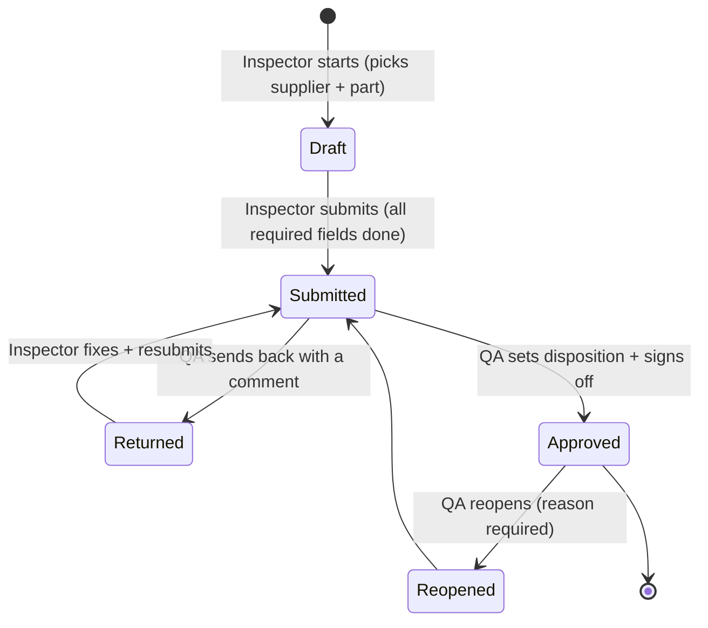

# 02 Spec — KHIND IQC (Incoming Quality Control) PRD

**Version:** 2.1 draft · **Date:** 2026-10-12 · **Status:** 🟡 for review
**Replaces:** [[02 Spec v1 - Todo MVP]] · **Comes from:** [[01 Idea]] · **Starting point:** `iqc-checklist-web.html`

> **Reading tip:** headers + bold text give the gist. P0 = must have for launch, P1 = fast follow, P2 = later.

**What changed in v2.1** (after the answers on 2026-10-12):
- **Budget:** no paid cloud plans. Production runs on **free tiers**, the risks are accepted and listed (§9), and there are safeguards.
- **Sampling:** KHIND has no licensed copy of the ANSI/ASQ Z1.4 or ISO 2859-1 sampling standards. The app uses **KHIND's own sampling table with zero defects allowed** ("c = 0", §7).
- **ISO:** KHIND is not ISO 9001 certified. Good record-keeping stays as good practice, not as an ISO requirement.
- **Hosting:** the MVP is a **demo on Vercel Hobby with fictional data**. No other host and no fallback. Daily real use is decided after the demo.

---

## 1. Problem statement

KHIND's IQC inspectors record incoming-lot inspections in a single-file HTML checklist that **saves only in the inspector's browser** and leaves as one Excel file per inspection. Because of this:
- QA, purchasing and management can't see results until a file is sent;
- sample sizes and accept/reject numbers are decided and typed by hand, so they vary between inspectors;
- sign-off is a typed name, with no proof of who approved, when, or whether data changed afterwards;
- supplier performance (lot acceptance rate, PPM) has to be compiled by hand.

The result is slow reaction to bad suppliers, inconsistent decisions, and weak evidence when a customer, a regulator (ST/SIRIM) or a supplier dispute asks *"show me the inspection for this lot"*.

## 2. Goals

| # | Goal | Measure | Target |
|---|---|---|---|
| G1 | Every incoming lot is recorded in one shared system | Lots in system ÷ lots received (from receiving log) | ≥ 90% by week 2, **100% by week 4** after real use starts |
| G2 | QA decides quickly | Inspections with a QA decision within 1 working day of submission | **≥ 95%** |
| G3 | Same sampling rule for everyone | Sampled inspections where sample size came from the KHIND table | **100%** (overrides only with a recorded reason) |
| G4 | Supplier quality without spreadsheets | Hours spent compiling the monthly supplier quality report | from today's baseline to **0** |
| G5 | Trustworthy records | Time to retrieve any inspection with its full change history | **< 1 minute** |

> **MVP = demo with fictional data.** G1–G4 are measured only once KHIND decides on daily real use (Q2). **The MVP succeeds when:**
> - an inspector completes a full inspection on a tablet in **≤ 15 minutes** for a typical lot;
> - QA approves it, a reject creates an NCR, and purchasing closes it;
> - the dashboard shows the numbers correctly;
> - QA confirms the flow matches how IQC really works.

## 3. Non-goals (v1)

| Not in v1 | Why |
|---|---|
| **Paid hosting or paid plans** | Budget decision. Free tiers only; see §9 for risks and safeguards. |
| **Official AQL tables (Z1.4 / ISO 2859-1)** | No licensed copy. KHIND's own table is used, and the design lets official plans be loaded later if KHIND buys the standard. |
| **ERP integration** (live POs, goods receipts) | Needs IT access and mapping work. Master data is kept in the app; ERP link is P2. |
| **Supplier portal** | Suppliers keep replying by email. v1 tracks the SCAR number and status. |
| **Offline mode** | Receiving area has Wi-Fi. Drafts autosave. |
| **Full 8D / CAPA workflow, gauge calibration management, multi-site, skip-lot** | Separate processes or later phases (P1/P2). |

## 4. Users and roles

| Role | Who | Can do |
|---|---|---|
| **Inspector** | IQC inspectors (2–5) | Create and edit **own drafts**; submit; view all inspections |
| **QA approver** | QA supervisor / engineer | Everything an inspector can; **approve / return / reopen**; set disposition; approve concessions; maintain master data and the sampling table |
| **Purchasing** | Purchasing / supplier quality | View all; update NCR supplier fields (SCAR/RMA no., supplier response, status) |
| **Management** | Managers | Read-only: dashboards, inspections, NCRs |
| **Admin** | QA manager or IT (1–2 people) | Invite users, assign roles, deactivate users, run data export / backup |

- **Invite-only.** Public sign-up is **off**: an admin invites users by email. This changes how the todo app worked.
- Roles are enforced **in the database** (Row Level Security), not only in the UI.

## 5. How an inspection flows



| Disposition (set by QA) | Meaning | Extra rule |
|---|---|---|
| Accept | Release to stores / production | Blocked if the system verdict is *Reject*, unless changed to concession |
| Accept with concession / deviation | Use despite nonconformity | Needs a **reason** and an approver with concession rights; creates an **NCR** |
| Sort / rework | Supplier or in-house sorting | Creates an **NCR** |
| Reject (return to vendor) | Send back | Creates an **NCR**; RMA / SCAR no. tracked by purchasing |

## 6. Requirements

### P0: must have for launch

**P0-1. Sign in and roles**
- [ ] Email + password sign-in. Sign-up is disabled; admins invite users and set roles.
- [ ] Each role can do only what §4 allows. A purchasing user can't approve an inspection, even by calling the server directly. Tested with database policies.
- [ ] Deactivated users can't sign in. Their past records keep their name.

**P0-2. Master data (maintained by QA)**
- [ ] **Suppliers:** code, name, status (*approved / probation / blocked*), contact email. Inspecting a *blocked* supplier shows a warning.
- [ ] **Parts:** part no., name, category, drawing no. + revision, *regulated electrical item* flag (needs an ST/SIRIM check), default template, inspection type (*sampling / 100% / no inspection*).
- [ ] **Inspection templates:** checklist sections and items (seeded from the HTML form's 6 sections and 26 items), dimensional characteristics (name, nominal, min, max, unit, defect class), functional tests.
  - **Versioned:** editing creates a new version, and past inspections keep the version they used.
- [ ] Nothing is hard-deleted. Records are marked *inactive*.

**P0-3. KHIND sampling table, computed by the system**
- [ ] QA maintains one **sampling table** in the app: lot-size bands → sample size, with a *normal* and a *tightened* column.
- [ ] The **acceptance rule is c = 0** for every defect class by default: **any defect found in the sample rejects the lot** (Ac = 0, Re = 1).
  - QA may relax a class, for example allowing 1 *minor* defect. The change is recorded in the audit trail.
- [ ] Given **lot size + stage (normal / tightened)**, the inspection shows the **sample size** and the accept/reject numbers. If the sample size is ≥ the lot size, inspect 100%.
- [ ] Inspectors can't change the sample size. QA can override it on an inspection with a reason, which is recorded.
- [ ] The demo seed table is **marked as an example**. QA must set the real values before any real use (Q1).
- [ ] The table design (`plan_source` column) lets official Z1.4 / ISO 2859-1 plans be loaded later without code changes.
- [ ] The calculation is unit-tested: band edges, 100% case, tightened stage, relaxed class.

**P0-4. Recording an inspection** (tablet-first; keeps everything the HTML form has)
- [ ] **Header:** date and time (auto), supplier and part (picked and auto-filled), PO no., DO / invoice no., lot / batch no., quantity received, receipt date. The inspector is the signed-in user.
- [ ] **Checklist:** OK / NG / N/A per item, notes per section. An **NG needs a comment**.
- [ ] **Dimensional:** characteristics from the template; *n* readings each (default 5, at most the sample size). Out-of-tolerance readings are highlighted, and each row gets an automatic OK / NG.
- [ ] **Instrument used** per dimensional section (free text).
- [ ] **Defects found** per class (critical / major / minor), with a description.
- [ ] **System verdict** is shown live: *Reject* if any class reaches its reject number. It warns *"Review before accepting"* when an item is NG or a dimension is out of tolerance but no defect was counted.
- [ ] **Photos, storage-conscious** (free plan storage is small, see §9):
  - only on **NG items and rejected or concession lots**, at most 3 per NG item and 6 per inspection;
  - **compressed in the browser to ≤ 200 KB** before upload;
  - kept in private storage.
- [ ] **Autosave** to the server about 2 seconds after each change, with a "Saved hh:mm" indicator.
- [ ] Can't submit until the required header fields, every checklist item, the defect counts and the dimensional rows (if the template has any) are complete. Missing items are listed and linked.

**P0-5. Review, approval and records**
- [ ] QA **"waiting for approval"** queue, oldest first.
- [ ] **Approve with disposition** or **return with comment**. Approval stores the **signed-in approver and server time**.
- [ ] **Approved inspections are locked.** Changes only via *Reopen* (QA, reason required).
- [ ] **Audit trail:** create, edits after submission, status changes, overrides, reopens and sampling-table changes go into an append-only log (who, when, field, old value, new value). It's visible on the page and can't be edited through the app.

**P0-6. Nonconformance report (NCR), minimal**
- [ ] Created automatically on *Concession*, *Sort / rework* or *Reject*, numbered `NCR-2026-0001`, with the linked inspection, quantity affected, defect summary and disposition.
- [ ] Purchasing fills in **SCAR no., RMA no., supplier response, status** (*open → waiting supplier → closed*) and the closed date.
- [ ] A list of open NCRs shows how many days each has been open.

**P0-7. Outputs and backup** (backup is required because the free plan has none)
- [ ] **Printable report / PDF** per inspection, including approver and timestamps.
- [ ] **Excel export** per inspection (4 sheets as today) and a filtered **list export**.
- [ ] **Admin "Export all data"**: one ZIP containing every table as CSV plus a photo index.
  - A **weekly backup routine** is documented: export, save to the QA folder in company OneDrive, keep 12 weeks.
  - The dashboard shows **"last backup: N days ago"** and turns red after 8 days.
- [ ] **Usage meter** (admin): database size and photo storage used as a % of free-plan limits. Warning at 70%, red at 85%.

**P0-8. Dashboard** (all roles; management lands here)
- [ ] For a selected period, each with a drill-down to the inspections behind the number:
  - lots inspected
  - **lot acceptance rate (LAR)**
  - lots rejected
  - **PPM defective**
  - pending approvals
  - open NCRs
  - median **receipt-to-decision time**
- [ ] A per-supplier table (lots, LAR, PPM, open NCRs), sortable.

### P1: fast follow (within about 6 weeks of launch)

| ID | Requirement |
|---|---|
| P1-1 | **KHIND escalation rules** (configurable; suggestions that QA confirms): <br>• after a **rejected** lot, the next **5 lots** of that supplier + part use *tightened* <br>• **5 accepted in a row** on tightened → back to *normal* <br>• **3 rejects in the last 10 lots** → suggest changing the supplier status to *probation* |
| P1-2 | **"What does this plan catch?" helper:** shows the chance that a c = 0 plan accepts a lot that is *p*% defective, which is (1 − p)ⁿ. Example: n = 50 accepts a 5%-defective lot about 8% of the time. Helps QA set the bands. |
| P1-3 | **Instrument register** (ID, name, calibration due date). An overdue instrument needs a QA override. |
| P1-4 | **Email notifications:** submitted → QA; returned → inspector; NCR created → purchasing; NCR over 14 days → purchasing + QA. Needs a sender other than Supabase's built-in email, which is rate-limited (Q4). |
| P1-5 | **Inspection label** printing (Pass / Hold / Reject with QR code → inspection page). |
| P1-6 | **CSV import** of suppliers and parts (initial load from an ERP export). |
| P1-7 | **Regulated item check:** for parts flagged *regulated*, the checklist requires "ST COA valid + SIRIM label present" with the COA no. recorded. |
| P1-8 | **Supplier scorecard** export (monthly PDF per supplier). |

### P2: later (design so these stay possible)

Official Z1.4 / ISO 2859-1 plans if purchased · ERP integration · supplier portal for SCARs · skip-lot · first article inspection (FAI) template · multi-site · SPC charts · offline mode · moving to paid or company hosting if the free-tier limits are hit.

## 7. Key rules and formulas

| Item | Definition |
|---|---|
| **Sample size** | From the KHIND table: the band that contains the lot size, in the current stage column. If sample size ≥ lot size → inspect 100%. |
| **Verdict (per class)** | With c = 0: **Reject if defects found ≥ 1**. If QA relaxed a class: Reject if found ≥ Re. The lot is rejected if any class rejects. |
| **Lot acceptance rate (LAR)** | lots with disposition *Accept* ÷ lots approved in the period × 100%. Concessions count as **not** accepted. |
| **PPM defective** | defective units found ÷ units inspected (sample, or the full lot for 100% inspection) × 1,000,000. The denominator is shown on the dashboard. |
| **Receipt-to-decision time** | approval time − receipt date/time; median per period. |
| **NCR age** | today − created (open NCRs); closed − created (closed NCRs). |

**Example KHIND sampling table (demo seed — NOT validated; QA must set the real values, Q1)**

| Lot size | Sample (normal) | Sample (tightened) | Accept if |
|---|---|---|---|
| 1 – 15 | all | all | 0 defects |
| 16 – 50 | 10 | 15 | 0 defects |
| 51 – 150 | 15 | 25 | 0 defects |
| 151 – 500 | 25 | 40 | 0 defects |
| 501 – 1,200 | 35 | 55 | 0 defects |
| 1,201 – 3,200 | 50 | 75 | 0 defects |
| 3,201 – 10,000 | 65 | 100 | 0 defects |
| 10,001 + | 80 | 125 | 0 defects |

> These numbers were written for this demo; they are **not** copied from any standard.

## 8. Non-functional requirements

| Area | Requirement |
|---|---|
| Devices | 10" tablet (portrait and landscape) and desktop; usable on a phone; touch targets ≥ 44 px. |
| Speed | Inspection page usable in under 2 s on dock Wi-Fi; autosave under 1 s. |
| Volume | Fewer than 30 lots a day, 5–15 users. |
| Security | Row Level Security on every table; private photo bucket with signed URLs; only the publishable key in the app. |
| Records | Approved records immutable; append-only audit trail; retention period per Q3. |
| Privacy | Data region Singapore; personal data limited to staff names and emails (PDPA). **No real KHIND data in the public GitHub repo**: demo seed uses fictional suppliers. |
| Language | English UI in v1; text kept in one place for Bahasa Malaysia / Chinese later. |

## 9. Hosting on free tiers: risks accepted, and safeguards

| Environment | Hosting | Data |
|---|---|---|
| **MVP = demo system**: course demo, plus showing the IQC flow to QA and management | **Vercel Hobby** (`khind-todo.vercel.app`); the only host in the MVP | Supabase Free, **fictional data only**; never real suppliers, parts or inspections |

> **Why fictional data only:** Vercel's terms limit Hobby to non-commercial use, and that includes a site built by paid employees. The MVP is a demo. Using it **daily with real KHIND inspections** needs a hosting decision after the demo (Q2, out of MVP scope).

| Risk | Impact | Safeguard |
|---|---|---|
| **No automatic backups** (Supabase Free) | Data loss if the project is damaged or data is deleted by mistake | P0-7 weekly "Export all data" to OneDrive with a red reminder after 8 days; approved records are locked; soft deletes only |
| **Project pauses after 7 days without activity** | App unavailable after long breaks (Hari Raya, CNY shutdown) | Data is kept while paused. Admin restores it from the Supabase dashboard on the first day back (runbook in the notes). Daily use normally prevents pausing. |
| **Photo storage about 0.5–1 GB, database 500 MB** | Uploads fail when full | Photos only for NG items, ≤ 200 KB each; usage meter warns at 70%; old photos archived to OneDrive. Estimate: about 1 MB/day of photos and ~20 KB per inspection → several years. |
| **Built-in email is rate-limited** | Invites or alerts delayed | Invites are rare (about 15 users). Alerts (P1-4) need another sender (Q4). |
| **Community-only support** | Slower help when something breaks | Runbook in the notes; this is a known trade-off |

## 10. Data model (first sketch)

```
profiles (user_id, full_name, role, active)
suppliers (id, code, name, status, email, active)
parts (id, part_no, name, category, drawing_no, drawing_rev, regulated, template_id, inspection_type, active)
templates (id, name, version, status) ─┬─ template_items (section, text, order)
                                       └─ template_characteristics (name, nominal, min, max, unit, defect_class)
sampling_bands (id, plan_source='KHIND', lot_min, lot_max, sample_normal, sample_tightened, active)
sampling_acceptance (plan_source, defect_class, ac, re)            ← default c=0: ac 0, re 1
inspections (id, number, status, supplier_id, part_id, template_version, po_no, do_no, lot_no,
             qty_received, received_at, stage, sample_size, sample_override_reason, verdict, disposition,
             inspector_id, submitted_at, approver_id, approved_at, concession_reason, site)
inspection_checks (inspection_id, item_id, result ok|ng|na, comment)
inspection_measurements (inspection_id, characteristic_id, readings[], result)
inspection_defects (inspection_id, class, found, ac, re, description)
attachments (inspection_id, check_id, storage_path, bytes)
ncrs (id, number, inspection_id, qty_affected, summary, disposition, scar_no, rma_no, supplier_response, status, closed_at)
audit_log (id, table, row_id, action, field, old_value, new_value, user_id, at)   ← append-only
backups (id, run_by, at, rows, note)
```

## 11. Success metrics

| Type | Metric | Success | Stretch | How / when |
|---|---|---|---|---|
| Leading | Lots recorded ÷ lots received | 90% week 2 | 100% week 2 | Receiving log comparison, weekly for 4 weeks |
| Leading | Median time to complete an inspection | ≤ today's baseline | −20% | Baseline in week 1 (draft start → submit) |
| Leading | Inspections returned for correction | < 10% | < 5% | Dashboard, monthly |
| Leading | QA decision within 1 working day | ≥ 95% | ≥ 99% | Dashboard, monthly |
| Leading | Weekly backup done | 100% of weeks | — | `backups` table |
| Lagging | Manual hours for monthly supplier report | 0 | 0 | Ask QA after month 2 |
| Lagging | NCRs with SCAR tracked to closure | 100% | 100% | NCR list, quarterly |
| Lagging | Free-tier usage | < 70% of every limit after 6 months | < 50% | Usage meter |

## 12. Open questions

| # | Question | Owner | Blocking? |
|---|---|---|---|
| Q1 | **KHIND sampling table:** QA to set the real lot-size bands and sample sizes (the demo table in §7 is only a starting point). Keep c = 0 for all classes, or relax *minor*? | QA | No for the demo; **yes** before real use |
| Q2 | **After the demo:** if KHIND wants daily use with real data, where will it be hosted? (Vercel Hobby's terms don't cover company use.) | Lee / management | No (not part of the MVP) |
| Q3 | How long must IQC records be kept? | QA / management | No (assume 7 years) |
| Q4 | Sender for email alerts (P1-4): company Microsoft 365 mailbox, or a free email service? | IT | No (P1) |
| Q5 | Who may approve concessions? Is a second approver needed for critical defects? | QA manager | No |
| Q6 | Should checklist NG items have a default defect class, or does the inspector always classify? | QA | No |
| Q7 | Which part categories are ST/SIRIM *regulated*, and what is checked at IQC? | Regulatory / QA | No (P1-7) |
| Q8 | Initial supplier/part list: who exports it, and in what format? | IT / Purchasing | No |
| Q9 | Label printer and label size (P1-5)? | QA / IT | No |

## 13. Timeline and phasing

| Phase | Scope | Rough size |
|---|---|---|
| **0. Prep** | QA reviews the example sampling table (Q1); prepare **fictional** demo suppliers, parts and templates based on the real checklist | 1 week |
| **1. MVP (P0)** | Roles, master data, sampling table, inspection recording, approval, audit trail, NCR, exports + backup, usage meter, dashboard | 4–6 weeks |
| **Demo** | An inspector and a QA approver walk through realistic **fictional** lots on a tablet; QA, purchasing and management review the flow and dashboard; test the backup export | 1–2 weeks |
| **Decision** | Go / no-go for daily real use, and where to host it (Q2) | — |
| **2. Fast follow (P1)** | Escalation rules, plan helper, instruments, emails, labels, CSV import, regulated check, scorecards | 3–4 weeks |

**Teaching note:** each phase becomes lessons, for example:
- roles and Row Level Security;
- versioned templates;
- the sampling table with tests and the (1 − p)ⁿ helper;
- the audit trail with database triggers;
- working within free-tier limits;
- dashboards.

## 14. What carries over from `iqc-checklist-web.html`

| Today | In the new system |
|---|---|
| 10 header fields | Same; supplier and part picked from master data; inspector = signed-in user |
| 6 checklist sections, 26 items, OK/NG/N/A + notes | Seeded as template v1; NG needs a comment; photos on NG items |
| Dimensional table (nominal / min / max / 5 samples, auto OK/NG) | Same, characteristics per part template, defect class per characteristic |
| Sampling plan "ANSI/ASQ Z1.4", level, sample size typed by hand | **KHIND table**: sample size **computed** from lot size |
| AQL table with AQL / Ac / Re / found typed by hand | **c = 0** by default: any defect rejects; the inspector enters defects found |
| "Review before accepting" hint | Kept as live verdict and warnings |
| Disposition (4 options), RMA/SCAR no., tag and label checkboxes | Kept; concession, sort and reject create an **NCR** |
| Typed sign-off names and dates | **Electronic sign-off** by signed-in users with server timestamps |
| localStorage + Excel per inspection | Shared database, audit trail, Excel/PDF exports, weekly full backup |

## Sources (research, 2026-10-12)

- Sampling and switching concepts: [SQC Online: switching rules](https://www.sqconline.com/switching-rules-mil-std-105e-z14), [Global Sources: anatomy of the Z1.4 AQL table](https://www.globalsources.com/knowledge/anatomy-of-the-ansi-asq-z1-4-industry-standard-aql-table/), [ANSI webstore: ASQ standards](https://webstore.ansi.org/sdo/asq)
- IQC workflow: [SAP Help: making the usage decision](https://help.sap.com/saphelp_46c/helpdata/en/e9/78a937776eca61e10000009b38f8cf/content.htm), [SAP Learning: inspections at goods receipt](https://learning.sap.com/learning-journeys/applying-sap-s-4hana-quality-management/processing-inspections-at-good-receipt_bf84141a-43bd-4744-a9f8-988655750611)
- IQC software features: [1factory: incoming quality control](https://www.1factory.com/incoming-quality-control-iqc.html), [ECOSIRE: ERPNext supplier quality scorecard](https://ecosire.com/apps/erpnext/erpnext-supplier-quality-scorecard)
- KPIs: [Tacto: supplier PPM target](https://www.tacto.ai/en/procurement-glossary-downloads/supplier-ppm-target), [Elsmar forum: supplier PPM](https://elsmar.com/elsmarqualityforum/threads/how-to-calculate-supplier-vendor-ppm.16554/page-2)
- Record-keeping good practice: [Open Exam Prep: release and nonconforming outputs](https://open-exam-prep.com/study-guides/cqi-irca-qms-lead-auditor/clause-8/clause-8-release-nonconforming)
- Malaysia ST / SIRIM: [ST: Guidelines for the Approval of Electrical Equipment (2024)](https://www.st.gov.my/contents/files/download/158/Guidelines%20for%20the%20Approval%20of%20Electrical%20Equipment%20(2024%20Edition).pdf), [TÜV SÜD: Malaysia market access](https://www.tuvsud.com/en/services/product-certification/global-market-access/malaysia)
- Free-tier limits and terms: [Vercel: fair use guidelines](https://vercel.com/docs/limits/fair-use-guidelines), [Vercel: Hobby plan](https://vercel.com/docs/plans/hobby), [Supabase free-tier limits 2026 (JetAdmin)](https://www.jetadmin.io/blog/supabase-pricing-2026-guide-to-plans-limits-and-real-world-costs/), [Supabase discussion: commercial use on free tier](https://github.com/orgs/supabase/discussions/21044)